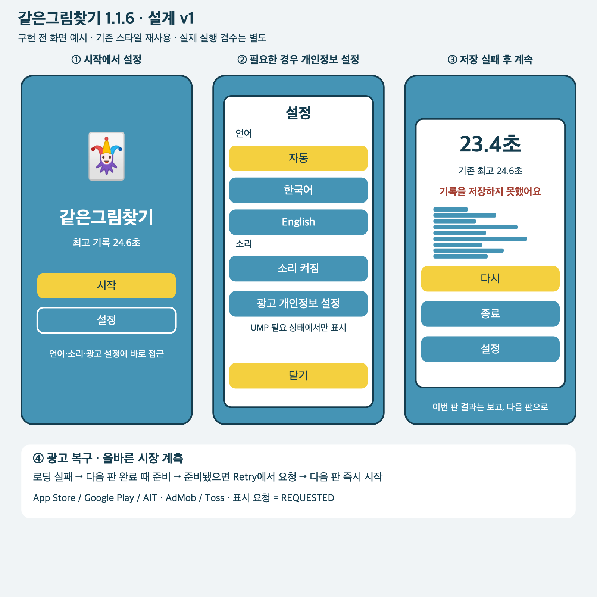

# 같은그림찾기 1.1.6: 기록 저장과 광고 설정 보완

- 설계 ID: `MP-IOS-116`, 버전: **v1**, 날짜: 2026-10-11.
- 상태: **v1 사람 승인 / 구현 완료·검수 중**. 2026-10-11 대화에서 사용자가 상세 설계 v1 확인 요청에 `승인`이라고 답했다. 승인 대상 문서 커밋은 `b8ed807c73bd7b8769d101aecc8fbe89cc6b2f07`이다. 구현·검수 완료는 별도로 기록한다.
- 기준 소스: `04357c7fff0eead3bdc4b6b6c334a7dc810fdb12`.
- 승인 커밋: `b8ed807c73bd7b8769d101aecc8fbe89cc6b2f07`. 실행 티켓: [#110](https://github.com/seorilabs/match-picture-app/issues/110). [구현·검수 기록](../../qa/MP-IOS-116/implementation.md). Ready PR: [#111](https://github.com/seorilabs/match-picture-app/pull/111). 원본 Unity와 Obsidian은 참고만 한다.

## 화면과 사용자 흐름



이 그림은 **구현 전 설계 예시**다. 기존 조커 이미지·파란 배경·노란 주요 버튼·파란 보조 버튼을 재사용한다. 한국어와 영어를 지원하며 새 아트 방향을 도입하지 않는다. 그림의 하단 설명과 UMP 조건 설명은 검토용 주석이며 제품에 추가하는 안내 문구가 아니다. 실제 레이아웃은 기존 UI 구성요소를 기준으로 세 화면비에서 확인한다.

- 시작 화면의 `시작` 아래에 보조 버튼 `설정 / Settings`을 둔다. 기존 결과 화면에서도 같은 설정을 연다. 설정을 닫으면 원래 화면을 유지하고 언어 변경을 즉시 반영한다.
- 설정의 소리 항목 아래에 `광고 개인정보 설정 / Ad privacy choices`을 둔다. UMP가 진입점 필요 상태를 반환한 네이티브 앱에서만 나타난다. 상태가 늦게 결정되면 현재 열린 설정에도 반영한다. 앱인토스·에디터에는 이 버튼을 표시하지 않는다.
- 누르면 UMP의 실제 양식을 연다. 열리는 동안 중복 입력을 막고, 닫힌 뒤 최신 동의로 광고를 준비한다. 실패 시 `설정을 열지 못했어요 / Could not open ad privacy choices.`를 설정 안에 짧게 표시한다. 게임 진행을 막지 않는다.
- 한 판 완료 → 기록 세 항목을 한 번에 저장 → 결과 표시. 실패하면 이번 판 시간과 구간은 보여 주되 `기록을 저장하지 못했어요 / Record not saved.`를 표시하고 저장된 기존 최고 기록을 유지한다. 신기록 저장 성공 표시와 별도 저장 재시도 버튼은 없다. `다시 / Retry`로 바로 계속할 수 있다.
- 광고 로딩 실패 → 다음 판 완료 때 한 번 준비 → 준비된 경우에만 Retry에서 표시 요청. 광고 유무와 관계없이 다음 판은 즉시 시작한다. 이 동작은 원본 Unity의 Retry → 광고 Show → StartGame 순서를 보존한다.

## 문제·범위·근거

| 수정 | 현재 확인한 문제 | v1에서 바뀌는 동작 |
|---|---|---|
| AC-1 기록 저장 | `main.gd`가 최고 시간·구간·완료 횟수를 세 번 쓰고 실패를 무시한다. `Save`가 쓰기 성공 전 메모리를 바꾼다. | 한 개 후보 스냅샷을 저장하고 성공한 뒤에만 메모리를 교체한다. 실패 알림과 이전 기록 유지. |
| AC-2 광고 복구 | AdMob 로드 실패 후 `_loading`만 해제하고, 다음 판 완료에서 재호출하지 않는다. | 판 완료 때 `prepare()` 호출. 이미 준비됐거나 로딩 중이면 중복 요청하지 않는다. |
| AC-3 개인정보 설정 | 시작 화면에서 설정에 갈 수 없고, UMP 개인정보 선택 양식 재진입 경로가 없다. | 시작 설정 버튼과 조건부 UMP 진입점. 기존 `npa=1`과 비추적 설정 유지. |
| AC-4 계측 | 모든 순위 제출 시장이 `ait`, 모든 광고 제공자가 `toss_ads`, 표시 요청이 `SHOWN`으로 기록된다. | 실제 시장·제공자로 분류하고 표시 요청은 `REQUESTED`, 건너뛰기는 `SKIPPED`로 기록한다. |

근거 소스: `godot/src/ui/main.gd`, `godot/autoload/save.gd`, `godot/src/platform/file_storage.gd`, `godot/src/platform/admob_interstitial_ads.gd`, `godot/src/ui/settings_popup.gd`, `godot/src/ui/title_screen.gd`. 원본 확인 지점: Unity `Assets/Scripts/GameSceneManager.cs`의 `GameResultPopup_OnRetry`.

Google은 필요 상태일 때 보이고 조작 가능한 개인정보 선택 진입점을 제공하도록 안내한다. [공식 iOS UMP 문서](https://developers.google.com/admob/ios/privacy#privacy_options). 저장소의 Poing 5.1.0에는 `get_privacy_options_requirement_status()`와 `show_privacy_options_form()`이 실제로 있으며 이를 사용한다. 없는 `can_request_ads()` 바인딩을 호출하거나 SDK 교체를 이 변경에 끼워 넣지 않는다. 기존 지원 동의 상태를 매 요청 시 재확인하고 미확정·필수 동의 미완료에서는 광고 요청을 차단한다. 이 제한의 네이티브 실제 동작은 실기기 검수로 확인한다.

게임 규칙·카드 수·정답 횟수·셔플의 원본 특성·난이도·콘텐츠·결제·광고 빈도는 이번 수정 대상에 포함하지 않는다. 공유 추가나 웹 시대 메타게임 복원도 없다.

## 책임·인터페이스·실패 처리

```text
UI main ── Save.set_values(변경 세 항목) ── FileStorage.write(전체 JSON)
       └─ 광고 포트 prepare / show / 개인정보 상태·완료 신호
              └─ AdMob 어댑터 ── 기존 Poing UMP·광고 SDK
```

- `Save.set_values(values: Dictionary) -> bool`을 추가한다. 현재 스냅샷의 깊은 복사에 변경을 합친 뒤 한 번 쓴다. 성공하면 `_data`를 교체한다. 기존 `set_value`도 이 경로를 사용한다.
- 저장 JSON 키·형식·스키마 1과 읽기 호환을 유지한다. 별도 이관이나 임시 호환 계층은 없다. `best_seconds`, `best_splits`, `clear_count`가 함께 확정된다. 저장 실패 시 이번 판의 순위 제출은 기존 흐름대로 시도하지만, 로컬 기록 저장 성공과 혼동하지 않는다.
- 파일 저장은 임시 파일 쓰기·오류 확인 후 교체한다. 정상 원본만 `.bak`으로 옮기며 각 rename 결과를 확인한다. 원본이 손상돼 백업에서 읽은 상태에서는 손상 원본으로 정상 백업을 덮지 않는다. 최종 교체 실패 때도 이전 정상 원본 또는 백업을 읽을 수 있어야 한다. JSON 형식과 한 세대 백업 방식을 유지한다.
- 광고 포트에는 기본 no-op `prepare()`, 개인정보 진입 필요 여부, 양식 표시 요청과 상태·완료 신호만 추가한다. SDK 호출은 플랫폼 어댑터에만 둔다. 개인정보 양식을 여는 동안 기존 광고와 이전 동의로 시작한 로드 결과를 사용하지 않으며, 늦게 도착한 결과는 해제한다. 동의가 결정되면 현재 상태에서 다시 준비한다. 로딩 실패에 자동 반복·타이머 재시도·새 빈도 규칙을 넣지 않는다.
- 시장 값은 `app_store`, `google_play`, `ait`; 광고 제공자는 `admob`, `toss_ads`다. 지원하지 않는 환경에서 시장을 추측해 전송하지 않는다. 이벤트 이름·허용 파라미터는 그대로 두고 값만 바로잡는다. `REQUESTED`는 실제 노출 증거가 아니며 실제 노출은 SDK 콜백·실기기 증거로 따로 판단한다.
- 원본·중앙 정책·서버 스키마·SDK·워크플로 변경이 필요하면 범위를 확장하기 전에 별도로 검토한다. 대안인 저장 재시도 버튼은 사용자 선택에 따라 채택하지 않았다.

## 품질·인수조건·검수

| 조건 | 통과 기준 | 검증 |
|---|---|---|
| AC-1 | 한 판의 세 기록을 한 번 쓴다. 실패 시 메모리·재실행 기록이 이전 값이고 결과에 짧은 실패 알림이 있다. 손상 원본에서도 정상 백업을 잃지 않는다. | 실패 저장 포트·독립 임시 파일로 실패 테스트 먼저 작성 → 수정 → 관련 회귀. 정상·저장 실패 결과의 실제 입력·렌더링. |
| AC-2 | 최초 로딩 실패 뒤 다음 판 완료에서 복구한다. 중복 로드가 없으며 광고 없음·실패 때 Retry가 진행된다. | 광고 대역으로 로드 실패·중복·늦은 콜백 확인. 네이티브 실제 테스트 광고 확인. |
| AC-3 | 시작에서 설정을 연다. 한국어·영어 변경 즉시 반영. 필요 상태에서만 개인정보 버튼이 보이며 성공·취소·실패·중복 입력이 처리된다. | 에디터에서 설정과 조건 상태 검증, iPhone/iPad에서 실제 UMP 양식·동의 변경·광고 흐름 확인. |
| AC-4 | iOS/Android/AIT의 시장·광고 제공자 값이 맞고 요청을 노출 성공으로 기록하지 않는다. | 플랫폼별 이벤트 대역·허용 파라미터 회귀. 기기 로그에서 실제 제공자 확인. |

- 전체 `npm run check`를 실행하고 `SCRIPT ERROR`·`ERROR:`까지 검사한다. 단위·헤드리스 테스트를 실제 UI·네이티브 SDK 검수로 표시하지 않는다.
- UI 검수는 실제 Godot Editor Run에서 기능과 UX를 세 번 확인한다. 매 회차 시작 전에 후보·격리 데이터·계획·증거 위치를 작성하고 구현자와 다른 리뷰 에이전트가 재현한다. 1회 전체 입력·결과, 2회 오류·취소·작은 화면·영문·포커스, 3회 기존 기능 연결·재시작·백업 복구를 집중 확인한다. 추가 회차는 별도 승인을 받는다.
- 목표 비율은 648×1440, 810×1440, 1080×1440. 기존 본문 글자 크기를 줄여 맞추지 않으며 긴 알림은 줄바꿈한다. 터치 영역·시각 대비·키보드 포커스·뒤로가기·팝업 입력 차단을 확인한다. 문자 입력이 없으므로 소프트 키보드 시나리오는 해당 없다.
- 전체 기능 목록에는 타이틀·최초 안내·카드 선택·오답/힌트·시간/구간/최고 기록·설정/소리/언어·뒤로가기/종료·안전영역·순위표·광고/개인정보·시장별 공유·계측을 포함한다. App Store에서는 실제 구현된 공유 버튼이 없음을 검증하고 스토어 설명의 공유 주장을 제거한다.
- 최종 SHA·App Store 대상·비밀값 없는 설정 지문·전체 기능 목록에 맞춘 E2E와 중앙 검증을 통과한 뒤 빌드한다. 네이티브 SDK·기기 검증의 미실행은 미확인으로 남긴다. 테스트 저장은 메모리 또는 확인된 독립 임시 디렉터리를 사용하며 사용자 저장을 초기화하지 않는다.
- 개인정보 변경이므로 최종 HEAD를 로컬 Claude로 읽기 전용 교차 리뷰한다. PR당 실패 포함 최대 두 요청, 지적·처리·CI 확인 뒤 승인된 흐름으로 병합한다.

## 적용·출시·복구

설계 v1 승인 → 실행 티켓 → 실패 테스트와 구현 → 세 번 UI 검수·교차 리뷰·한국어 Ready PR·CI·병합 → 최종 후보 E2E·중앙 검증 → App Store 1.1.6 빌드·업로드 → 처리 확인·TestFlight iPhone/iPad QA → 한국어/영어 설명·실제 스크린샷·지원 URL·개인정보 read-back → 심사 재제출 → 승인·공개·live 확인 순서다. 가격·국가와 승인 후 자동 출시 설정을 유지한다. 이번 출시 대상은 App Store다.

검토 때 1.1.5는 unresolved/rejected 상태였다. [Apple의 unresolved 제출 처리 절차](https://developer.apple.com/help/app-store-connect/manage-submissions-to-app-review/manage-a-submission-with-unresolved-issues/)에 따라 기존 거절 버전 기록을 1.1.6과 새 빌드로 갱신하고 재제출하는 경로를 먼저 확인한다. 실제 상태를 다시 읽고, 기존 기록 수정이 막히면 원인부터 보고한다. 심사 철회·중복 제출 생성·심사관이나 지원팀 메시지는 이 설계로 실행하지 않는다.

브라우저에서만 처리할 개인정보·심사 내역 확인은 App Store Connect 로그인 복구가 필요하다. API 인증과 브라우저 로그인은 별개다. 승인 설계·코드·CI·업로드·심사·승인·공개·실기기/live 결과를 각각 보고한다.

배포 전 결함이면 PR을 수정하거나 되돌린 뒤 해당 근거를 새 후보로 다시 실행한다. 이미 공개된 iOS 바이너리의 즉시 롤백을 약속하지 않으며 필요하면 후속 수정 버전을 제출한다. 저장 스키마를 바꾸지 않으므로 기존 정상 기록은 계속 읽을 수 있다.

## 승인·추적

이 문서와 `preview.svg`/`preview.png`를 함께 **v1 승인 범위**로 고정한다. 승인 기록에는 사람의 답변과 문서 커밋을 연결한다. v1 승인 근거는 이 대화의 사용자 답변 `승인`이다. 구현·검수·스토어 변경의 상태는 실행 티켓과 검수 보고서에 별도로 기록한다. Wiki 게시 대신 저장소 `docs/design/README.md`에서 정본을 연결한다. 사전 합의만을 상세 설계 승인이나 검수 통과로 소급 기록하지 않는다.
