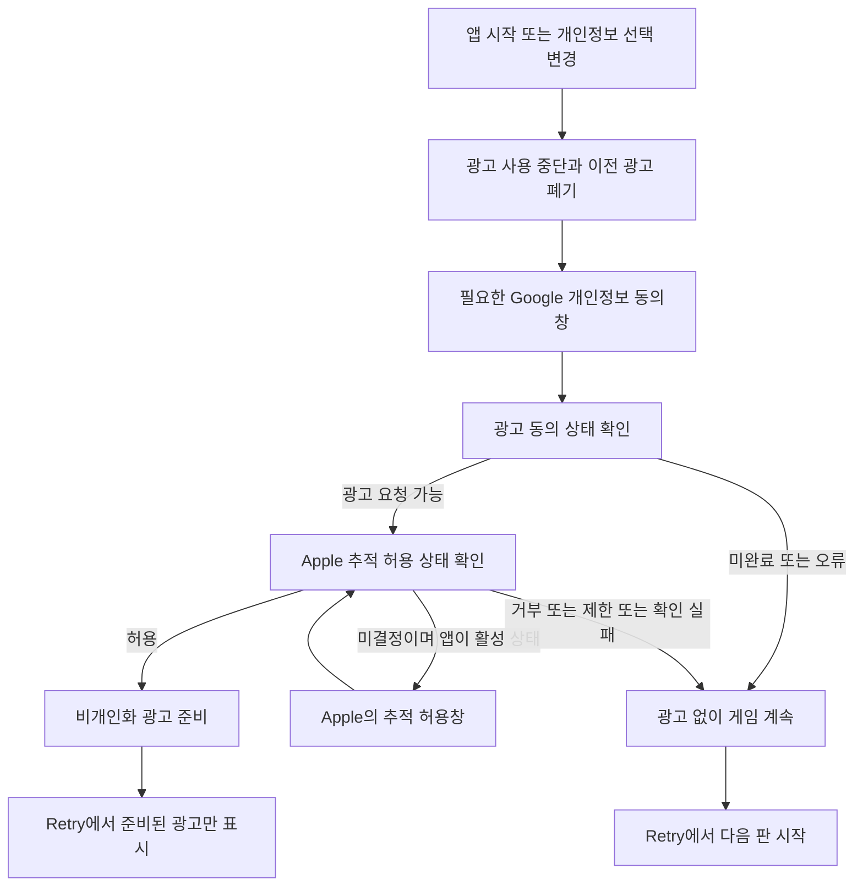
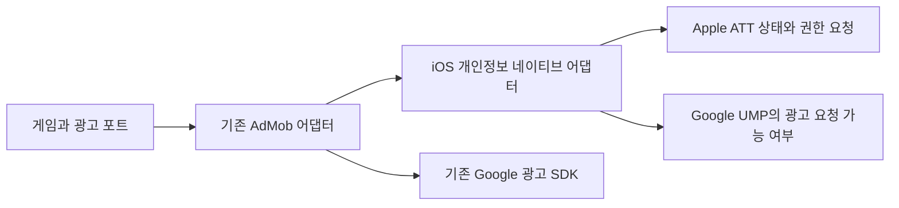

# 같은그림찾기 1.1.7: 광고 추적 동의와 개인정보 공개 정합성

- 설계 ID: `MP-IOS-117`, 버전: **v1**, 날짜: 2026-10-13.
- 상태: **사람 검토 대기**. 다음 버전 준비와 재심사 요청은 받았으며, 아래 광고 동작과 구현 범위의 승인은 아직 받지 않았다.
- 기준 소스: `d2cfb6fbd6c7100ba7f9a72a7a955d959b5ca67f`.
- 대상: App Store 앱 `1528539634`, bundle `com.github.magicsih.MatchSymbol`. 예정 버전 `1.1.7`; 태그와 빌드 번호는 최종 후보 검수 뒤 중앙 원장에서 발급한다.
- 근거: [현재 거절 제출](https://appstoreconnect.apple.com/apps/1528539634/distribution/reviewsubmissions/details/162856a7-6e04-4531-a840-53613e8df83e), [준비·검수 상태](../../../app-store/releases/1.1.7/preparation.md).

## 사용자 흐름과 동작 결정

**v1의 핵심 결정:** iOS에서 ATT를 허용하기 전에는 광고 SDK를 초기화하거나 광고를 요청하지 않는다. 거부·제한·확인 실패 상태에서는 광고 없이 정상 플레이한다. 허용해도 기존 `npa=1`을 유지하며 맞춤형 광고로 바꾸지 않는다. 광고를 허용하는 사용자가 줄어 수익이 감소할 수 있다. 게임 기능·기록·순위표는 추적 허용 여부로 제한하지 않는다.

- GDPR 동의창이 필요 없는 지역에서도 ATT 확인 절차는 수행한다. 두 동의는 독립적이며 Google 동의창으로 ATT를 대체하지 않는다.
- 시스템 상태가 미결정인 경우에만 앱이 활성 상태이고 다른 동의창이 닫힌 뒤 ATT를 요청한다. 이미 허용·거부·제한인 경우 시스템 창을 반복 요청하지 않는다.
- 앱을 재실행하거나 시스템 설정에서 권한을 바꾸고 돌아오면 현재 상태를 다시 읽는다. 광고 로드 시작·완료·표시 직전에도 허용 여부를 확인해 철회 전 광고를 사용하지 않는다.
- 권한 대기나 네트워크 오류 때문에 타이틀·게임·Retry를 막지 않는다. 중복 요청을 합치고 늦은 콜백이 현재 동의나 광고 준비 상태를 되돌리지 않도록 한다.
- 별도 설득 화면·허용 보상·거부 경고를 추가하지 않는다. Apple의 시스템 창과 기존 Google 양식을 사용한다. 기존 시각 방향을 유지하므로 새 아트 시안 선택은 해당 없다.

## 목적·범위·근거

Apple은 `1.1.6 / 1001006`에서 GDPR 화면이 맞춤형 광고와 데이터 공유에 대한 동의를 요구하지만 ATT를 요청하지 않는다고 지적했다. 현재 App Store 개인정보 공개는 추적 없음이며, 이전 제출의 SDK manifest 대조와 네이티브 검수는 완료되지 않았다. 앱 동작·동의창·공개 답변을 함께 검증하고 새 바이너리로 재심사를 요청한다.

| 포함 | 변경 목적 |
|---|---|
| iOS 네이티브 개인정보 어댑터와 AdMob 초기화·요청·표시 조건 | 실제 ATT 상태와 SDK의 광고 요청 가능 여부 확인 |
| iOS export의 ATT framework·용도 설명·지역화·네이티브 연결 검사 | 업로드할 앱에 실제 권한 요청 경로 포함 |
| SDK manifest·현재 광고 설정·App Privacy·개인정보 페이지 대조 | 화면과 공개 답변의 불일치 해소 |
| 새 후보의 독립 검수·E2E·iPhone/iPad 검수·심사 메모 | 실제 수정 결과를 검수하고 기존 제출에 연결 |

게임 규칙, 11장 덱, 정답 10회, 셔플의 원본 특성, 콘텐츠, 저장 스키마, 광고 표시 기회, 결제는 변경하지 않는다. 원본 Unity와 기존 Obsidian 기획은 참고 자료이며 수정하지 않는다. Android와 AppsInToss의 출시·개인정보 동작 변경은 이번 대상이 아니다.

공식 근거: [Apple 추적 허용 요건](https://developer.apple.com/app-store/user-privacy-and-data-use/), [Google iOS 개인정보 전략](https://developers.google.com/admob/ios/privacy/strategies), [Google 비개인화 광고의 식별자 사용](https://developers.google.com/admob/ios/privacy/ad-serving-modes), [Google SDK 데이터 공개 안내](https://developers.google.com/admob/ios/privacy/data-disclosure).

## 구조·책임·의존성

- 게임 규칙과 `godot/src/core/`는 플랫폼 SDK를 알지 않는다. 권한 로직은 `godot/src/platform/`과 iOS 네이티브 플러그인에 한정한다.
- 작은 iOS 네이티브 플러그인은 ATT 상태 읽기·시스템 권한 요청·현재 UMP `canRequestAds` 조회만 제공한다. IDFA 자체를 읽거나 자체 동의 데이터를 저장하지 않는다. 기존 Poing 5.1.0 GDScript 바인딩에는 UMP의 해당 조회가 없어 SDK의 실제 값을 연결한다.
- 기존 AdMob·UMP 버전과 공개 광고 식별자는 유지한다. vendored SDK 전체 교체나 임시 외부 호환 계층을 추가하지 않는다.
- 앱에 포함되는 플러그인에서 ATT를 직접 요청한다. AdMob 콘솔의 앱 전체 IDFA 메시지를 새로 켜는 방식은 채택하지 않는다. 기존 TestFlight 바이너리에 예기치 않은 동작을 만들지 않고 요청 순서를 앱 안에서 검증하기 위함이다.
- iOS export 준비·검사 스크립트에서 정적 라이브러리와 framework 연결, 목적 문구, 지역화, 플러그인 포함을 확인한다. 필요한 경우 기존 중앙 workflow의 준비·export hook을 연결하는 얇은 caller만 변경한다. 중앙 계약 변경은 별도 설계 범위다.
- 깨끗한 checkout에는 현재 AdMob iOS native payload가 없는 것을 확인했다. 기존 검증한 버전의 공식 배포물과 해시를 확인해 재현 가능한 준비 경로를 만든 뒤 검사한다. 사용자 checkout의 무시된 바이너리를 출처 확인 없이 새 빌드의 근거로 삼지 않는다.

## 데이터·인터페이스·실패 처리

예정 네이티브 인터페이스는 `tracking_status()`, `request_tracking_authorization()`과 완료 신호, `can_request_ads()`다. 미결정·거부·제한·허용을 구분하며 UMP의 실제 광고 요청 가능 여부와 ATT 허용을 함께 만족해야 iOS 광고를 사용한다. 에디터에서는 주입한 대역으로 상태와 지연·중복·오류를 검수한다. 실제 시스템 상태를 대역 결과로 증명하지 않는다.

- 네이티브 연결이 없거나 API가 예상과 다르면 광고를 중단한다. 게임은 계속 가능하며 릴리스 산출물 검사는 실패해야 한다.
- OS가 관리하는 ATT 상태와 UMP가 관리하는 동의를 앱 저장 파일에 복제하지 않는다. OS 상태를 덮거나 사용자 기록을 초기화하지 않는다.
- 개인정보 선택을 다시 열면 준비된 광고를 폐기한다. 이전 세대의 광고 로드·동의 완료 콜백은 현재 요청을 덮지 못한다.
- 단순 타임아웃을 동의나 허용으로 간주하지 않는다. 다음 명시적인 준비 기회·앱 활성화에서 상태를 다시 확인하되 자동으로 동의창을 반복하지 않는다.

ATT 목적 문구 초안은 아래와 같다. 실제 최종 용도와 번들 포함·한국어/영어 표시를 검수하고 확정한다.

- 한국어: `광고 효과를 측정하기 위해 다른 회사의 앱과 웹사이트에서의 활동과 연결할 수 있도록 허용을 요청합니다.`
- 영어: `Allow linking your activity across other companies' apps and websites to measure advertising effectiveness.`

## 개인정보 공개와 품질 요구사항

최종 archive에 포함된 모든 SDK manifest, 실제 광고 요청 설정, 활성 계측 설정을 함께 읽는다. `npa=1`, ATT 거부 시 IDFA 없음, framework 포함만으로 전체 앱의 비추적 또는 신원 비연결을 확정하지 않는다.

현재 공개된 다섯 유형뿐 아니라 광고 데이터 등 실제 수집 유형 누락, 목적, 신원 연결, 추적 여부를 유형별로 검토한다. 허용 시 추적이 가능한 제품의 App Privacy에는 해당 추적을 공개한다. 모든 유형을 일괄적으로 추적 또는 연결로 체크하지 않는다. 최종 SDK와 설정 근거를 유형별 답변·확인 시각에 연결하고 저장 후 다시 읽는다.

`seorilabs-official`의 기존 개인정보 페이지가 이 동작을 정확히 설명하는지 검토한다. 필요하면 같은 공식 사이트에 한국어/영어 앱별 페이지를 만들고 PR·배포·URL 확인 뒤 Connect에 연결한다. 이 작업은 실제 SDK와 근거가 확인된 범위로 한정한다. 예외 승인 요청이나 심사팀 회신은 이번 실행 경로에 포함하지 않는다.

- 사용자 데이터·권한 상태·광고 식별자 값을 로그·문서에 남기지 않는다. 검수에는 허용 여부와 단계·시간만 기록한다.
- 거부·오류 상태에서도 게임 시작·완료·저장·Retry가 정상 동작해야 한다.
- Apple 시스템 화면에서 작은 iPhone, iPad, 큰 글자와 한국어·영어 문구를 확인한다. 별도 앱 입력란이 없어 키보드 시나리오는 해당 없다.

## 대안·결정

| 대안 | 판단 |
|---|---|
| Apple의 버그 수정 예외 요청으로 기존 바이너리 승인 | 현재 요청의 새 버전 수정·재심사 목표에 사용하지 않음 |
| 비개인화 광고 설정만 근거로 ATT 없이 재제출 | Google 양식·실제 추적·공개 답변 불일치를 해소하지 못하므로 제외 |
| UMP의 원격 IDFA 메시지로 ATT 요청 | 앱 전체 설정 영향과 실제 ATT 상태 확인 문제로 이번에는 제외 |
| ATT 거부 후에도 비추적 광고 유지 | 별도 비추적 광고 경로의 실제 증명이 필요하므로 이번에는 제외 |
| 앱 내부 ATT 요청과 허용한 경우에만 광고 사용 | v1 제안. 거부 시 추적 위험을 차단하며 수익 영향은 승인 대상 |

## 인수조건·테스트·검수

| ID | 통과 조건 | 검증 |
|---|---|---|
| AC-1 | 활성 앱의 미결정 상태에서 UMP 창과 겹치지 않게 ATT를 한 번 요청하고, 완료 전 광고 초기화·요청 0회 | 실패 테스트 후 상태 대역·지연 콜백 검증, 실제 iPhone/iPad 화면과 단계 기록 |
| AC-2 | ATT 거부·제한·오류·UMP 미완료·플러그인 없음에서 광고 초기화·요청·표시가 없고 정상 플레이 가능 | 각 상태와 기존 광고 철회·늦은 로드 콜백 회귀 테스트, 기기 요청/네트워크 검수 |
| AC-3 | 두 동의 조건 통과 뒤 비개인화 광고를 준비하고 기존 Retry 기회에서만 표시, 재실행·권한 철회 반영 | 테스트 광고로 요청·노출·재시작·설정 변경 실제 확인 |
| AC-4 | signed app에 native plugin·ATT framework·목적 문구·두 언어가 포함되고 사용자 저장 형식 유지 | export/archive 자동 검사, 실제 실행 확인 |
| AC-5 | SDK 실제 동작·manifest·개인정보 페이지·App Privacy 유형별 답변 일치 | 최종 archive 대조와 모든 활성 언어·질문 저장 후 read-back |
| AC-6 | 기존 제출의 1.1.7과 최종 빌드가 재접수되고 실제 상태 확인 | Connect API·콘솔 read-back. 승인·공개와 구분 |

가능한 상태·광고 요청 차단·지연 콜백 요구사항은 테스트 실패를 먼저 확인하고 최소 구현한다. OS 권한창·SDK 실제 통신·서명은 대역 테스트로 증명할 수 없어 실제 실행·archive 검사로 보완한다.

독립 UI 검수는 구현자와 다른 에이전트가 3회 진행한다. 각 회차는 실행 전 후보·계획·격리 저장 경로·기대 결과를 기록한다. 1회는 허용과 게임 전체 흐름, 2회는 거부·오류·문구·화면 크기, 3회는 재실행·권한 변경·기존 기능 회귀에 집중하며 매 회차 기능과 UX를 함께 검수한다. 네이티브 동의·광고는 영향받은 기반 기능이므로 후보당 실제 기기 확인을 수행한다. 추가 회차는 중앙 정책에 따른다.

전체 기능 목록과 App Store 설정 지문·최종 SHA에 맞춘 빌드 전 E2E를 수행하고 최신 중앙 검증기를 실행한다. 기존 광고의 미검증 결과를 이어받아 통과로 표시하지 않는다. 개인정보·빌드 연결 변경은 최종 HEAD에서 읽기 전용 로컬 Claude 교차 리뷰와 한국어 Ready PR·CI를 거친다.

## 적용·운영·되돌리기·승인

설계 v1 승인 → 실행 티켓 → 테스트와 구현 → 독립 검수·교차 리뷰·PR 병합 → 최종 후보 E2E·중앙 검증 → 1.1.7 archive·업로드 → 처리·TestFlight 확인 → iPhone/iPad QA → 개인정보·모든 활성 언어·심사 메모 검수 → 기존 거절 제출에 새 버전·빌드 연결 → 재접수 read-back 순서다.

실제 기기 QA에 앞서 사용자 저장 위치와 기존 기록을 확인하고 보존한다. ATT 재현을 위한 재설치는 별도 검수 앱 식별자 또는 테스트 데이터가 확인된 기기에만 한다. 사용자 앱·저장을 임의 삭제하지 않는다.

현재 연결된 실제 기기는 iPhone 12 Pro다. 연결된 실제 iPad는 확인되지 않았으므로 iPad QA는 미실행 상태다. 환경 부족을 통과나 면제로 표시하지 않는다.

Connect의 기존 버전 ID `1d36616f-cdc7-4d53-abcc-f3442c26a261`과 제출 ID `162856a7-6e04-4531-a840-53613e8df83e`를 먼저 다시 읽고, 수정 가능한 기존 버전에 `1.1.7`과 최종 빌드를 연결한다. 중복 제출·제출 철회·항목 삭제를 하지 않는다. 가격·지역·`AFTER_APPROVAL` 설정은 기존 값을 확인해 보존한다. 이번 완료 목표는 재심사 접수이며 공개 검수는 별도 상태다.

빌드·검수 전에 문제가 발견되면 PR 범위의 코드를 수정하거나 되돌리고 후보별 근거를 다시 만든다. 미공개 새 후보를 수정하는 것과 공개 바이너리 롤백은 구분한다. 최종 소스·SDK·설정이 달라지면 이전 근거를 재사용하지 않는다.

이 문서의 **v1 광고 동작·범위**와 문서 커밋을 사람 승인에 결속한다. 승인 후에는 이미 요청받은 새 버전 준비와 재심사 단계의 권한을 반복 확인하지 않는다. 제출 성공은 심사 승인이나 공개 완료로 표현하지 않는다.
