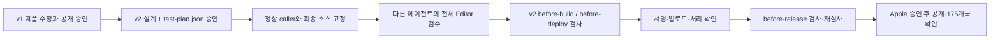

# MP-IOS-118 v2: 승인 범위를 테스트 계획으로 결속

- 상태: **이 변경 설계와 test-plan.json의 정확한 커밋은 사람 승인 대기**.
- 제품 변경 정본: [v1](design.md), 승인 커밋 b2bbb2c324a12b6a517a0b2391f08794fdf6bf69. 원문과 승인 이력을 보존한다.
- 기존 실행: [Issue116](https://github.com/seorilabs/match-picture-app/issues/116), [PR115](https://github.com/seorilabs/match-picture-app/pull/115), [기록](execution.md).
- 대상·끝 지점: **App Store 1.1.8/1001008 재심사 → Apple 승인 후 MANUAL 공개 → 기존 175개국 공개 버전 확인**. 정식 태그·번호는 최종 후보 검수 뒤 발급한다.

## 변경 사유와 범위

v1 승인 뒤 중앙 PR248이 3a2c19afd7b323d15f0de79728039a2717237acb로 병합됐다. [최신 개발 정본](https://github.com/seorilabs/.github/blob/3a2c19afd7b323d15f0de79728039a2717237acb/docs/agent-governance/development-workflow.md)은 “새 grant는 추가하지 않는다. 실기기 생략 같은 결정은 승인된 테스트 계획의 floorOverrides로 남긴다.”라고 정한다. 계획은 설계와 같은 커밋으로 사람 승인을 받아야 한다. b2bbb2c에는 test-plan.json이 없어 새 grant 등록 대신 정상 v2 계획·실행 근거로 결속한다.

제품 동작·두 도메인·SDK·ATT/UMP·비개인화 광고·GA4 비활성·게임 규칙·저장·개인정보 7개 항목은 v1대로 유지한다. 새 grant를 등록하지 않고 App Store caller의 옛 예외 입력을 제거한 정상 검증 경로를 사용한다. 중앙 빌드·서명·업로드 구현, 권한, 인증을 바꾸거나 검증기를 생략하지 않는다. 변경은 앱의 승인 계획·근거와 caller 연결이다.

## 테스트 계획과 미검증 판정

[테스트 계획](test-plan.json)은 **L3 / dev**다. v1 AC-4의 **13개 전체 기능 Editor 검수 범위를 유지**하며 줄이지 않는다. 구현자와 다른 에이전트가 최종 후보 SHA에서 전부 실제 실행한다. foundationRerun=true로 기반 기능의 과거 실행도 이어받지 않는다. 새 화면·UI 개편이 없어 redesign=false이며 새 시각 검수 3회는 해당 없다.

baseline=v1.1.7은 실제 전체 Editor 회귀를 통과한 마지막 릴리스 태그다. 물리 iOS·네트워크 통과 또는 공개 완료 근거는 아니다. export 경로의 전체 회귀 하한은 충족하고, 경로가 겹치는 광고·개인정보/리더보드/분석의 실기기 하한만 승인된 floorOverrides로 낮춘다. 생략은 이번 **1.1.8/1001008만**, 만료 **2026-10-20T13:41:40Z(10월 20일 22:41:40 KST)**까지이며 자동 연장하지 않는다.

물리/native는 계속 **not_verified/waived**, 전체 제품 E2E는 **blocked**다. Editor의 SDK 대역은 실제 OS 프롬프트·광고 통신·Game Center·분석 전송 검수가 아니다. 계획한 dev 기능의 실패·차단은 통과로 쓰지 않으며 과거 7bb 후보의 기동·부분 실행·중단을 새 최종 후보 결과로 복사하지 않는다. 실행은 최종 SHA에서 168시간 안의 실제 시각·입력·결과·원본 근거로 기록한다.

## 인수조건·운영·복구

v1 AC-1~3의 16개 엄격 검사, 실제 Godot export와 최종 서명 archive의 root/SDK 세 선언 전체 대조를 유지한다. AC-4는 새 최종 SHA와 이 계획의 승인 커밋, 전체 13기능, 독립 실행자를 결속한 v2 근거로 검증한다. before-build와 before-deploy는 중앙 CI가, before-release는 심사 제출 직전 실행자가 최신 중앙 검증기로 검사한다. 통과 기록은 검사한 범위만 설명하며 실기기 생략을 PASS로 바꾸지 않는다.

AC-5~6의 기존 계정·빌드·메타데이터·정책·개인정보 실제 readback, 기존 제출 관계 재확인, 재심사·승인·공개·live 상태 분리는 유지한다. 기존 ASC 키와 서명 identity를 재사용하고 연락처를 보존한다. 기존 1.1.7 grant·태그·빌드1001007을 새 후보에 재사용하지 않는다.

만료·검사 차단·사용 불가 환경·승인 범위 밖의 거절이면 상태를 기록하고 공개를 중단한다. 검증기를 우회하거나 후보·실행 시각을 꾸미지 않는다. 원본 CI 보고서의 추가 공개 공유 보류를 유지하며 실제 CI artifact와 private 원본을 보존한다. 정상 검증에 필요한 최소 실행 근거 자산은 별도로 검토하고 원본 보고서·비밀값을 포함하지 않는다. 사용자 저장과 기존 공개 버전을 보존한다.

이 변경 설계와 같은 커밋의 test-plan.json 승인은 정상 v2 계획으로의 전환에만 필요하다. 기존 수정·재심사·Apple 승인 후 공개 승인을 다시 요청하는 것이 아니다. 승인 뒤 계획의 끝 지점까지 진행한다.
