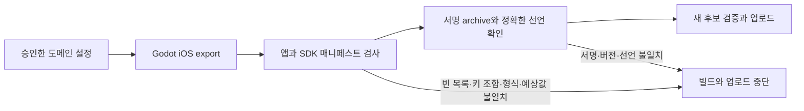

# MP-IOS-118 v1: 추적 매니페스트 오류 수정

- 상태: **사람 검토 대기**. 구현·새 태그·빌드·재제출은 아직 승인되지 않았다.
- 기준: `ff3317a66feac0c2ebf349f2e47c93dfd70db8bb`, 기존 `v1.1.7 / 1001007`.
- 대상: App Store `1528539634` / `com.github.magicsih.MatchSymbol` / Seori Labs `HCDUXX4Z3X`.
- 제안 후보: **1.1.8 / 1001008**. 중앙 SemVer 인코딩 결과이며 정식 번호·태그는 승인·최종 검수 후 발급한다. 기존 태그는 보존한다.
- 승인: 대기. 이 문서의 v1 커밋과 범위에 사람 승인을 결속한다. 실행 Issue와 구현 PR은 승인 후 연결한다.

## 목적·근거와 변경 전후

사용자가 Apple의 `ITMS-91064` 메일 대상이 **1.1.7(1001007)**임을 확인했다. 실제 App Store 버전은 `INVALID_BINARY`, 제출은 `UNRESOLVED_ISSUES`이고 업로드 빌드 처리 상태는 별도로 `VALID`다.

기존 `tools/finish_ios_privacy.py::check_manifests`는 앱의 `NSPrivacyTracking=true`를 요구하면서 비어 있지 않은 도메인 목록을 거부한다. 같은 조건의 로컬 재현 파일과 실제 SDK 선언 두 개를 검사했을 때 기존 검증기는 3개 매니페스트를 통과시켰다. [Apple TN3181](https://developer.apple.com/documentation/technotes/tn3181-debugging-invalid-privacy-manifest)은 `true`와 빈 도메인 배열의 조합을 유효하지 않다고 명시한다. 로컬 검증 계약의 결함을 재현했으며, 업로드된 IPA 원본 자체는 보관되어 있지 않아 그 파일의 원문을 읽었다고 주장하지 않는다.

| 항목 | 기존 | v1 제안 |
|---|---|---|
| 앱의 추적 선언 | `true` | `true` 유지 |
| 추적 도메인 | 빈 배열 | `googleads.g.doubleclick.net`, `pagead2.googlesyndication.com` |
| 매니페스트 검사 | 잘못된 조합을 통과시키고 도메인 추가를 거부 | Apple 키 조합·형식 검사와 승인 도메인 정확 일치 |
| 후보와 실기기 예외 | 1.1.7의 고정 소스·지문에 한정 | 새 SHA·지문·후보의 별도 중앙 승인 결속 |

두 도메인은 기존 Google Mobile Ads **13.9.0**의 arm64 바이너리에서 확인한 정적 endpoint다. 공식 배포물의 SHA256 `cd356c1fe78f0b19abe9b0722affc128dfcaf9f863fd69c379cc47d46275d7bb`는 기존 검토 원본과 일치한다. 이는 SDK 정적 근거이며 실제 통신 캡처나 전 지역의 동적 광고 호스트 검수를 뜻하지 않는다. [Google 데이터 공개 안내](https://developers.google.com/admob/ios/privacy/data-disclosure)와 [Apple TN3182](https://developer.apple.com/documentation/technotes/tn3182-adding-privacy-tracking-keys-to-your-privacy-manifest)를 함께 적용한다.

## 흐름·책임·실패 처리

- 앱 설정: `godot/export_presets.cfg`의 iOS 추적 도메인을 명시하고 `#` 주석의 Godot ConfigFile 해석 문제도 유효한 `;` 문법으로 정리한다.
- 검사: `tools/finish_ios_privacy.py`가 root와 SDK 원본 전체를 검사한다. 새 도메인 목록, `true` 값, 기존 데이터 유형·목적과 SDK 선언을 대조한다. 임의로 root 플래그를 `false`로 바꾸거나 SDK 파일을 편집하지 않는다.
- 검증 근거: 실제 서명 archive의 root/SDK 매니페스트 원문 해시와 키 조합을 기존 CI 검수 산출물에 남긴다. 원본을 공개 GitHub Release에 추가 공유하지 않는다.
- 중앙 예외: 새 후보·설정에 맞는 grant와 caller 결속을 새로 검토한다. 기존 `match-picture-1.1.7` grant·승인·원본은 변경하거나 재사용하지 않는다. 필요한 중앙 변경은 새 grant 등록과 후보 결속에 한정한다.
- 타임아웃·Apple 처리 실패·재거절 시 실제 저장값을 먼저 읽고 중복 업로드나 무조건 재제출하지 않는다. 기존 ASC 키·서명 identity를 재사용한다.

## 사용자 동작과 품질 범위

기존 ATT/UMP 순서, ATT 허용 전 광고 차단, 거부·오류 때 광고 없이 게임 계속, `npa=1`, SDK 버전, 한국어·영어 ATT 문구, App Privacy 7개 유형, 별도 앱 GA4 비활성, 게임 규칙과 저장 형식을 유지한다. Android/AIT 출시·지원팀 회신·새 키 생성·중앙 업로드 경로 변경은 포함하지 않는다.

새 화면·입력·아트가 없어 시각 설계와 추가 제품 UI 검수 회차는 해당 없다. 도메인 선언은 iOS의 추적 통신 차단에 영향을 줄 수 있다. 이미 ATT 허용 뒤에만 광고를 요청하는 앱 조건과 대조한다. 실제 OS/광고 통신이 미검증인 위험은 그대로 명시하며 Editor 대역 검수를 실기기 통과로 쓰지 않는다.

## 인수조건·테스트·검수

| ID | 조건 | 방법 |
|---|---|---|
| AC-1 | `true`+빈 배열, `true`+도메인 누락, `false`+비어 있지 않은 배열, 문자열 Boolean, URL/경로/쿼리/공백/잘못된 도메인을 거부 | Apple 계약을 기준으로 실패 테스트를 먼저 확인한 뒤 수정 |
| AC-2 | root의 두 승인 도메인과 `true`, 기존 수집 선언, GMA13.9.0/UMP3.1.0 원문이 정확히 일치 | 실제 Godot export와 서명 archive 검사·원문 해시 보존 |
| AC-3 | 실제 SDK 선언 추가·누락·변조 또는 도메인 추가·삭제를 거부 | 기존 엄격 비교와 관련 회귀 검사 유지 |
| AC-4 | 새 SHA·App Store·설정 지문·13개 기능 목록에 맞춘 Editor 검수와 중앙 before-build/before-deploy 검사 | 새 후보의 실제 실행 근거 생성, 기존 SHA의 결과를 새 결과로 복사하지 않음 |
| AC-5 | Apple에서 1.1.8/정식 빌드 처리를 읽고 매니페스트 오류 해소·메타데이터·개인정보 공개·정책 URL 확인 후 재심사 | 기존 버전/제출 관계와 모든 활성 로케일·이미지를 다시 읽고 실제 접수 상태 보존 |
| AC-6 | Apple 승인 뒤 기존 175개국 MANUAL 공개와 실제 공개 버전 확인 | 서명·심사·승인·공개 상태 분리, 새 거절·예외 만료/철회 때 중단 |

OS 프롬프트·SDK 네트워크·실기기 E2E는 자동 테스트로 증명할 수 없다. **승인 요청 범위에는 이번 새 1.1.8 후보의 실기기 검수 생략을 포함한다.** 물리/native는 `not_verified/waived`, 전체 제품 E2E는 `blocked`로 유지한다. 새 예외의 만료는 현재 승인과 같은 `2026-10-20T13:41:40Z`로 제한하고, 독립 검토·실제 Editor·서명·SDK·개인정보·중앙 검증·Apple 승인·공개 조회는 면제하지 않는다.

## 대안·적용·복구·승인

- 채택: 추적 선언을 유지하고 현재 고정 SDK에서 확인한 도메인을 명시한다. 기존 광고 동작을 보존하면서 빈 목록 오류를 해결한다.
- 제외: 추적 플래그만 `false`로 변경하거나 빈 도메인 키만 지우는 처리. 승인된 추적 공개와 실제 SDK를 일치시킨다는 근거가 없어 채택하지 않는다.
- 제외: 1001007 재업로드·v1.1.7 재태깅·옛 grant로 새 SHA 실행. 동일 번호·후보 결속을 위반한다.
- 적용: v1 사람 승인 → 실행 티켓 → 실패 테스트·최소 수정 → 교차 리뷰/Ready PR/CI → 새 후보 Editor와 중앙 예외 등록 → 정식 1.1.8 태그·서명 업로드 → 실제 오류 해소 확인·재심사 → Apple 승인 → 현재 예외/근거 확인·수동 공개.
- 복구: 공개 전 검사 실패면 후보를 수정하고 새 근거를 만들며 공개를 중단한다. 기존 사용자 저장·공개 버전·1.1.7 원본을 보존한다. 승인된 기간을 자동 연장하지 않는다.
- 이 문서 v1 승인 질문에는 **수정·검수·새 후보 실기기 예외·iOS 재심사·Apple 승인 후 공개**를 명시한다. 승인 전에는 문서·진단만 준비하고 구현·태그·빌드·제출을 진행하지 않는다.
