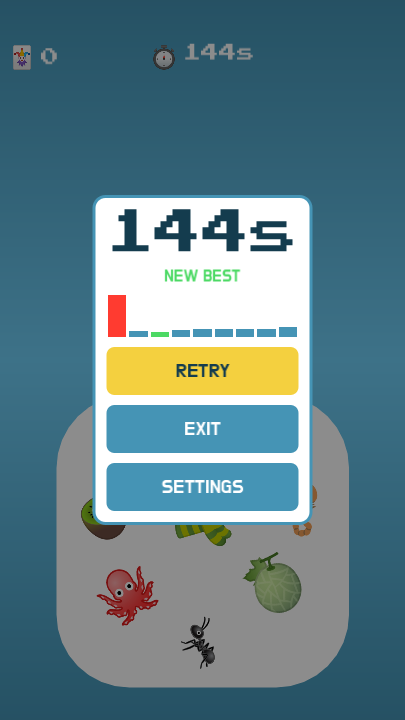
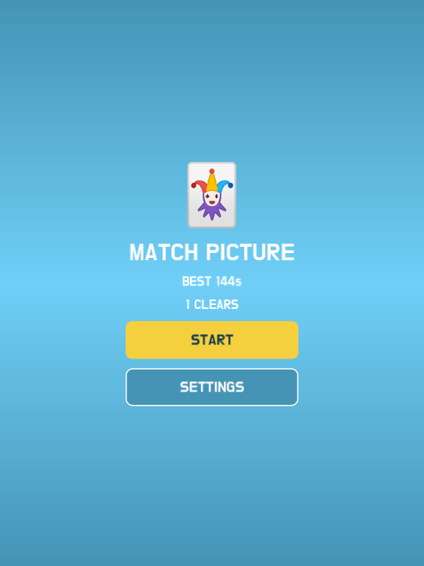

# MP-IOS-117 독립 검수 결과

승인된 3회 독립 Editor 검수를 마쳤다. 확인한 게임·설정·저장과 광고 어댑터 대역의 기능·UX는 기대와 일치했다. **실제 네이티브 광고·권한 및 최종 E2E는 blocked**이며 출시·심사 제출의 완료를 뜻하지 않는다.

| 회차 | 고정 후보 | 실제 Editor Run | 주요 근거·초기 미검증 |
|---|---|---|---|
| [1회차](iteration-1.md) | `87658f511215bb5227e876118e4f7e979ee5d859` | 1회, 324×720 | 실제 10정답·156초/9구간, 미결정 광고 0회·허용/npa/Retry. 유휴 힌트와 실디스크는 미검증으로 보존 |
| [2회차](iteration-2.md) | `5c9d3b37d03509429078321fc53fe295564262d4` | 1회, 324×720 | 거부/제한/연결없음/조회실패 광고 0회, 실제 10정답·저장 실패 문구/기존값 유지, 유휴 전갈 좌우 흔들림 100프레임 |
| [3회차](iteration-3.md) | `1fc334b170fd87c4e10d484112057846f59f22be` | 사전 조율한 4개 시나리오, 405×720·540×720 | ATT 대기 복구/철회·늦은 광고 폐기, 정상 main 144.973초/9구간 파일 저장·primary 재실행·backup 복구/후속 쓰기 |

구현자 `/root`와 별도 검수자 `/root/privacy_ui_review`가 수행했다. 승인 설계는 [MP-IOS-117 v1](../../design/2026-10-13-ios-1.1.7-ad-privacy/design.md), 승인 대상 커밋은 `c92196fab6a302832c4919f71ff745cb3d280db6`다. 회차마다 계획·후보 archive·환경·격리 guard를 실행 전에 준비했고, 실제 EditorInterface Run의 GUI child에 CUA 입력을 보냈다. headless Editor host와 실제 GUI child를 구분했다. 무제한 재시도나 추가 4회차는 하지 않았다.

13개 전체 기능을 각 회차 문서에서 확인한다. 광고·ATT·UMP는 실제 어댑터 상태 로직에 SDK만 대역으로 주입했다. 게임 완료는 매회 실제 하단 정답 10회로 만들었다. SDK 호출 계수와 `npa=1`은 소스 동작 근거이며 실제 Apple 시스템창·UMP 네트워크·광고 요청/노출 성공으로 바꾸어 기록하지 않는다. 기존 기반 기능의 실기기 통과 근거를 승계하지 않았다.

1회차에서 창이 가려진 동안 입력/시간 표시가 정체된 관찰은 원문에 남겼다. 이후 창 Raise를 명시적으로 수행하여 진행했으나 원인을 제품 결함으로 확정하지 않았다. 1회차 힌트 미검증은 [2회차 이동](evidence/round-2-hint-left.png)·[반대 이동](evidence/round-2-hint-right.png)과 3회차 프레임으로 해결 근거를 연결했다. 1·2회차 메모리 저장 결과를 실제 디스크 근거로 바꾸지 않았고, 정상 main의 3회차 저장·재실행·복구를 따로 연결했다.

모든 실행 GUI는 제품 Yes로 종료했다. 자기 Editor host도 종료했고 전용 Godot 실행 프로세스가 남지 않았음을 확인했다. 제품 소스·기존 사용자 저장·기기 저장·전역 설정·원래 Godot 앱은 수정하지 않았다. 네이티브 .a가 없는 archive의 ad_privacy.gdip 경고는 보존했다. game 로그의 SCRIPT ERROR/ERROR는 모두 0이며, 확인한 범위의 새 제품 결함은 없다.

최종 소스에서는 다음 gate가 남는다.

- 실제 iPhone·iPad의 ATT/UMP 순서, 허용·거부·철회, 테스트 광고, 네트워크 및 safe area/awake 검수. iPad는 환경 없음·미실행이다.
- 회차 중 후속 수정된 허용 상태 활성 복귀의 광고 재로드 제한과 native 빌드/manifest 스크립트. 3회차는 원 후보만 확인했으며 후속 변경은 미재확인이다.
- 같은 최종 SHA·마켓·설정·기능 목록의 E2E와 중앙 검증. Editor 대역 근거로 native 기반 기능을 통과시키지 않는다.

공개 근거는 회차 문서, 상대 경로로 정리한 공개 로그, 실제 원본 PNG의 복사본과 SHA-256이다. 개인 환경 경로가 있는 raw 로그·환경·manifest·helper·저장 스냅샷은 **개인 아티팩트 보관소의 MP-IOS-117 검수 묶음**으로 복사 보존했다. 원본과 복사본의 파일별 해시를 비교하며, 보존 묶음 지문은 [evidence-manifest.json](evidence-manifest.json)에 기록한다. ignored build 근거를 공개 소스나 worktree 스냅샷 보존에 의존하지 않는다.
